# SponsorFlow — Data Flow Diagrams (DFD)

This document presents the functional data flows for **SponsorFlow**, detailing how data moves between actors, internal processes, and the relational MySQL data store.

---

## 1. Context Diagram (Level 0 DFD)

The Context Diagram portrays the boundaries of the entire system as a single process interacting with external entities.

```
                    +---------------------------+
                    |          ACTORS           |
                    |  (Admin, Manager, Staff)  |
                    +---------------------------+
                      |                       ^
   User Credentials / |                       | Dashboard KPIs /
   Company Data /     |                       | Reports / Details /
   Outreach Notes /   |                       | Flash Alerts
   Proposal Inputs    |                       |
                      v                       |
             +-------------------------------------+
             |                                     |
             |                 0.0                 |
             |             SponsorFlow             |
             |       Event Sponsorship CRM         |
             |                                     |
             +-------------------------------------+
                      |                       ^
      Store / Update  |                       | Query Data /
      Records         |                       | Read Relations
                      v                       |
                    +---------------------------+
                    |            D1             |
                    |      MySQL Database       |
                    |   (Aiven Cloud / Local)   |
                    +---------------------------+
```

---

## 2. Level 1 Data Flow Diagram (Decomposed Processes)

Level 1 breaks down the main system into 7 distinct functional sub-processes.

```mermaid
flowchart TD
    %% Entities
    U["Actors (Admin / Manager / Staff)"]
    DB[("D1: MySQL Database")]

    %% Process 1: Authentication
    P1["1.0 Authentication & Session Management"]
    U -->|"Credentials (Email, Password)"| P1
    P1 -->|"Query Hash & Role"| DB
    DB -->|"User Record"| P1
    P1 -->|"Session Cookie & Auth Guard"| U

    %% Process 2: Company & Contact Management
    P2["2.0 Company & Contact Management"]
    U -->|"Company / Contact Details, Search Filters"| P2
    P2 -->|"Insert, Update, Delete Companies/Contacts"| DB
    DB -->|"Filtered Company & 360 View Records"| P2
    P2 -->|"Rendered Tables, Modal Data"| U

    %% Process 3: Outreach & Communication
    P3["3.0 Outreach Logging"]
    U -->|"Call, Email, Meeting Log & Notes"| P3
    P3 -->|"Store Outreach Record & Update Last Contact"| DB
    DB -->|"Outreach History"| P3
    P3 -->|"Touchpoint Feed"| U

    %% Process 4: Follow-up Scheduling
    P4["4.0 Follow-up Engine"]
    U -->|"Schedule Task, Mark Complete"| P4
    P4 -->|"Store / Update Task Status"| DB
    DB -->|"Follow-up Records (Dates, Priorities)"| P4
    P4 -->|"Classified Tasks (Overdue, Today, Upcoming)"| U

    %% Process 5: Proposal Management
    P5["5.0 Proposal Management & Negotiation"]
    U -->|"Package Details, Amount, Validity"| P5
    P5 -->|"Store Proposal Record"| DB
    DB -->|"Proposal History"| P5
    P5 -->|"Proposal Quotation View"| U

    %% Process 6: Sponsorship & Deliverables Governance
    P6["6.0 Sponsorship & Deliverables Fulfillment"]
    U -->|"Convert Accepted Proposal / Deliverable Update"| P6
    P6 -->|"Create Sponsorship, Update Stage, Log Tasks"| DB
    DB -->|"Contract & Deliverable Statuses"| P6
    P6 -->|"Fulfillment Progress Bars, Financial Totals"| U

    %% Process 7: Reporting & Executive Analytics
    P7["7.0 Reporting & Analytics Engine"]
    P7 -->|"SQL Aggregations (Sums, Conversion Rates)"| DB
    DB -->|"Aggregate Metrics"| P7
    P7 -->|"Pipeline Charts, Cash Flow Summaries"| U
```



---

## 3. Process Specifications

### 1.0 Authentication & Session Management
- **Inputs:** Email, Password, CSRF token.
- **Outputs:** Authenticated PHP session (`$_SESSION['user_id']`), role cookie, user dashboard redirect.
- **Data Store Interactions:** Queries `users` table via prepared statement; verifies bcrypt password hash.

### 2.0 Company & Contact Management
- **Inputs:** Company name, industry, location, status, contacts details.
- **Outputs:** Companies directory table, detailed 360° company profiles.
- **Data Store Interactions:** Inserts/updates `companies` and `contacts` tables; cascades deletions; appends audit events to `activities`.

### 3.0 Outreach Logging
- **Inputs:** Communication type (Email, Call, WhatsApp, Meeting), subject, notes, sponsor response.
- **Outputs:** Chronological outreach log.
- **Data Store Interactions:** Writes to `outreach` table; updates `last_contacted` timestamp in `contacts`.

### 4.0 Follow-up Scheduling
- **Inputs:** Target date, priority, objective, completion trigger.
- **Outputs:** Active task queue classified dynamically against `CURRENT_DATE()` into Overdue, Today, and Upcoming.
- **Data Store Interactions:** Writes to `followups` table.

### 5.0 Proposal Management
- **Inputs:** Package name, fee quotation, validity window, terms.
- **Outputs:** Formal proposal records, status transitions (Draft → Sent → Viewed → Negotiation → Accepted).
- **Data Store Interactions:** Reads and writes to `proposals` table.

### 6.0 Sponsorship & Deliverables Fulfillment
- **Inputs:** 1-click proposal conversion trigger, deliverable items, deadlines, owners.
- **Outputs:** Active sponsorship records, contractual entitlements checklist, fulfillment percentage.
- **Data Store Interactions:** Writes to `sponsorships` and `deliverables`; updates company status to `Confirmed`.

### 7.0 Reporting & Executive Analytics
- **Inputs:** Date and filter parameters.
- **Outputs:** Financial pipeline charts, conversion ratios, distribution graphs.
- **Data Store Interactions:** Performs real-time `SUM()`, `COUNT()`, and `GROUP BY` aggregations across all transactional tables.
