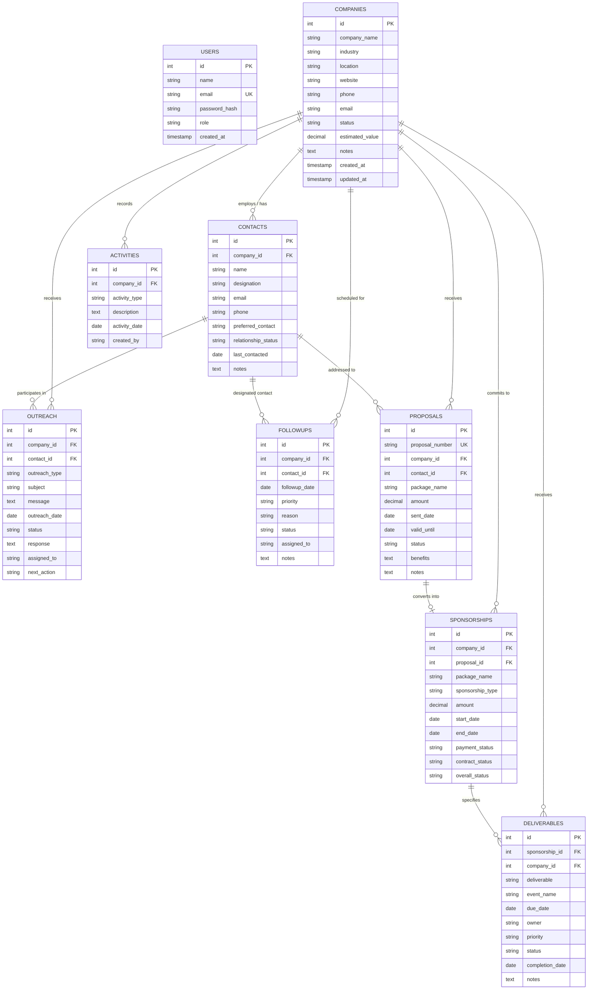

# SponsorFlow — Entity Relationship (ER) Diagram

This document models the conceptual and logical entity relationships in the **SponsorFlow** database.

---

## 1. Mermaid ER Diagram

---

## 2. Cardinality & Relationship Breakdown

### 1. `COMPANIES` to `CONTACTS` (1 : N)
- **Cardinality:** One company can have zero, one, or many key contacts.
- **Rule:** A contact must belong to exactly one company.
- **Foreign Key:** `contacts.company_id` references `companies.id`.
- **Constraint:** `ON DELETE CASCADE`.

### 2. `COMPANIES` to `OUTREACH` (1 : N)
- **Cardinality:** One company can have multiple outreach interactions logged over time.
- **Foreign Key:** `outreach.company_id` references `companies.id` (`ON DELETE CASCADE`).
- **Contact Link:** `outreach.contact_id` references `contacts.id` (`ON DELETE SET NULL`).

### 3. `COMPANIES` to `FOLLOWUPS` (1 : N)
- **Cardinality:** A company can have multiple scheduled follow-ups.
- **Foreign Key:** `followups.company_id` references `companies.id` (`ON DELETE CASCADE`).
- **Contact Link:** `followups.contact_id` references `contacts.id` (`ON DELETE SET NULL`).

### 4. `COMPANIES` to `PROPOSALS` (1 : N)
- **Cardinality:** Multiple proposals can be issued to a single company across negotiations.
- **Foreign Key:** `proposals.company_id` references `companies.id` (`ON DELETE CASCADE`).

### 5. `PROPOSALS` to `SPONSORSHIPS` (1 : 1 or 1 : 0)
- **Cardinality:** An accepted proposal can be converted into at most one commercial sponsorship.
- **Foreign Key:** `sponsorships.proposal_id` references `proposals.id` (`ON DELETE SET NULL`).

### 6. `SPONSORSHIPS` to `DELIVERABLES` (1 : N)
- **Cardinality:** A confirmed sponsorship agreement includes multiple contractual deliverables.
- **Foreign Key:** `deliverables.sponsorship_id` references `sponsorships.id` (`ON DELETE CASCADE`).

### 7. `COMPANIES` to `ACTIVITIES` (1 : N)
- **Cardinality:** Every interaction, status change, and proposal generation logs an entry into the company's activity audit trail.
- **Foreign Key:** `activities.company_id` references `companies.id` (`ON DELETE CASCADE`).
